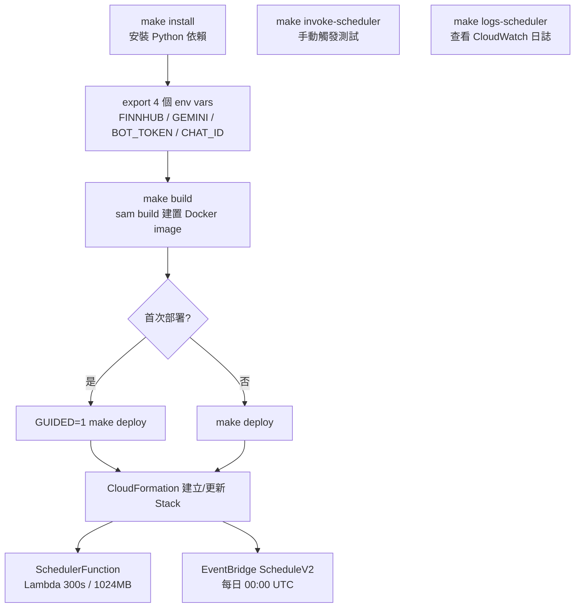
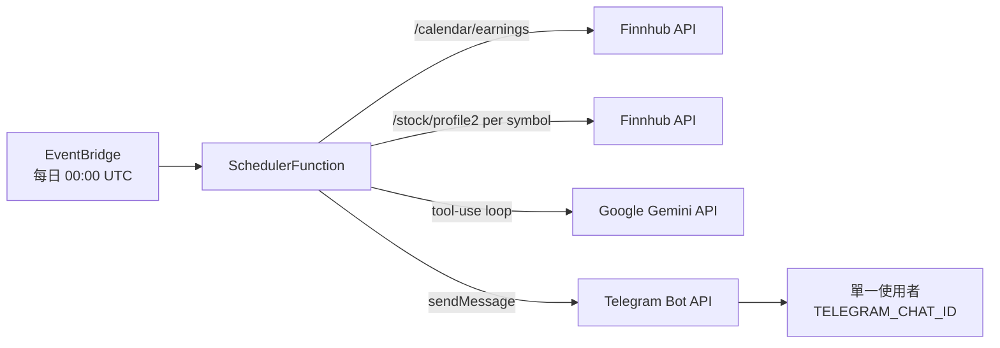

# 部署流程說明

## 架構總覽

本專案使用 **AWS SAM (Serverless Application Model)** 部署，Lambda 以 **Docker container image** 方式打包，部署至 AWS `ap-northeast-1`。整個 stack 只有一個 Lambda function，由 EventBridge 每日觸發一次。

---

## 部署流程圖



## 執行流程圖



---

## 步驟詳解

### 1. 前置作業

```bash
make install                       # uv sync
export FINNHUB_API_KEY=...
export GEMINI_API_KEY=...
export TELEGRAM_BOT_TOKEN=...
export TELEGRAM_CHAT_ID=123456789  # 你的數字 chat id
```

`make deploy` 會檢查這 4 個 env var，缺一就 fail fast。

### 2. 建置

```bash
make build
```

執行 `sam build`，根據 `infra/template.yaml` 與 `Dockerfile` 建置 Lambda 用的 Docker image。

**Dockerfile 流程：**
1. 基於 `public.ecr.aws/lambda/python:3.11`
2. 安裝 `google-genai`、`httpx`、`aws-lambda-powertools`
3. 複製 `src/agent/` 至 container
4. CMD 指向 `agent.scheduler_handler.handler`

### 3. 部署

```bash
GUIDED=1 make deploy   # 首次
make deploy            # 後續
```

SAM 部署流程：
1. Docker image 推送至 ECR（`--resolve-image-repos` 自動建 repo）
2. SAM 用 `--resolve-s3` 自動建/沿用 managed bucket 暫存模板
3. 4 個 secret 透過 `--parameter-overrides` 傳入並設為 NoEcho 的 SAM Parameters
4. CloudFormation 套用 changeset

### 4. 驗證

```bash
make invoke-scheduler   # aws lambda invoke，立即跑一次
make logs-scheduler     # tail CloudWatch logs
```

正常會在 1–2 分鐘內收到 Telegram 推播。沒有財報的日子（週末、無科技公司公布）Lambda 會 log "no tech earnings tomorrow, skip push" 並 return 200，不會送訊息。

---

## AWS 資源清單

| 資源類型 | 名稱 | 用途 |
|----------|------|------|
| Lambda | `earnings-agent-scheduler` | 每日推播（300s timeout, 1024MB） |
| EventBridge | ScheduleV2 | 每日 00:00 UTC 觸發 |
| ECR | `schedulerfunction` | Lambda container image |

沒有 API Gateway、SQS、DynamoDB、SSM。AWS 端基本上停留在免費額度內。

---

## 本地開發

```bash
make test   # PYTHONPATH=src uv run pytest tests/ -v
```

測試用 `pytest-mock` mock Finnhub HTTP 與 Gemini，不需要 AWS credentials。
