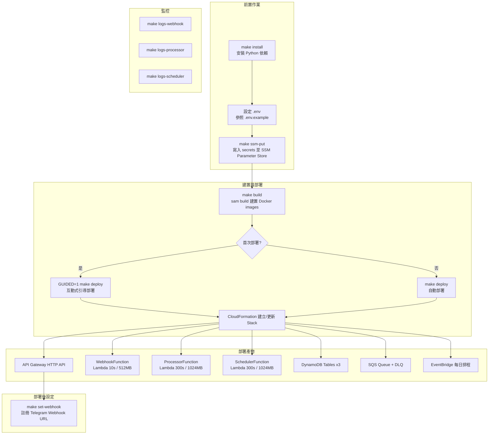
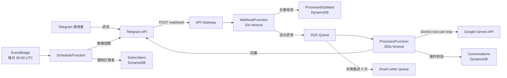

# 部署流程說明

## 架構總覽

本專案使用 **AWS SAM (Serverless Application Model)** 進行部署，所有 Lambda function 皆以 **Docker container image** 方式打包，部署至 AWS `ap-northeast-1` region。

---

## 部署流程圖



## 請求處理流程圖



---

## 步驟詳解

### 1. 前置作業

| 步驟 | 指令 | 說明 |
|------|------|------|
| 安裝依賴 | `make install` | 使用 `uv sync` 安裝 Python 依賴 |
| 環境變數 | 複製 `.env.example` → `.env` | 填入 `GEMINI_API_KEY`、`FINNHUB_API_KEY`、`TELEGRAM_BOT_TOKEN`、`TELEGRAM_WEBHOOK_SECRET` |
| 寫入 Secrets | `make ssm-put` | 將 secrets 寫入 AWS SSM Parameter Store（`/earnings-agent/*` prefix） |

### 2. 建置

```bash
make build
```

執行 `sam build`，根據 `infra/template.yaml` 和專案根目錄的 `Dockerfile` 建置三個 Lambda function 的 Docker image。

**Dockerfile 流程：**
1. 基於 `public.ecr.aws/lambda/python:3.11`
2. 安裝 `google-genai`、`httpx`、`boto3`、`aws-lambda-powertools`
3. 複製 `src/agent/` 原始碼至 container
4. 三個 function 共用同一個 image，透過 SAM template 的 `ImageConfig.Command` 指定不同 handler

### 3. 部署

```bash
# 首次部署（互動式引導）
GUIDED=1 make deploy

# 後續部署
make deploy
```

SAM 部署流程：
1. 將 Docker images 推送至 ECR（自動建立 repository）
2. 產生 CloudFormation changeset
3. 執行 changeset，建立/更新所有 AWS 資源

**部署參數**（`infra/samconfig.toml`）：
- Stack name: `earnings-agent`
- Region: `ap-northeast-1`
- Capabilities: `CAPABILITY_IAM`

### 4. 部署後設定

```bash
make set-webhook
```

呼叫 Telegram Bot API 的 `setWebhook`，將 API Gateway 的 URL 註冊為 Webhook endpoint。

### 5. 監控

```bash
make logs-webhook     # 查看 Webhook Lambda 日誌
make logs-processor   # 查看 Processor Lambda 日誌
make logs-scheduler   # 查看 Scheduler Lambda 日誌
```

---

## AWS 資源清單

| 資源類型 | 名稱 | 用途 |
|----------|------|------|
| API Gateway HTTP API | WebhookApi | 接收 Telegram webhook |
| Lambda | `earnings-agent-webhook` | 接收請求、去重、轉發 SQS（10s timeout） |
| Lambda | `earnings-agent-processor` | 執行 AI agent 對話（300s timeout） |
| Lambda | `earnings-agent-scheduler` | 每日推播財報提醒（300s timeout） |
| DynamoDB | `earnings-agent-conversations` | 對話歷史（有 TTL） |
| DynamoDB | `earnings-agent-subscribers` | 推播訂閱者 |
| DynamoDB | `earnings-agent-processed-updates` | Telegram update 去重（有 TTL） |
| SQS | `earnings-agent-updates` | 非同步處理佇列 |
| SQS (DLQ) | — | 失敗訊息暫存（保留 14 天） |
| EventBridge | ScheduleRule | 每日 UTC 00:00 觸發 |

---

## 本地開發

```bash
make dev    # 啟動 FastAPI 本地伺服器（port 8080）
make test   # 執行測試（使用 moto mock AWS 服務）
```

### 本地開發 webhook 切換

Telegram webhook 是全域設定，本地開發期間可暫時把它切到 ngrok，讓 Telegram 訊息直接打到本機 FastAPI 伺服器，測完再切回雲端。

1. **啟動本機伺服器**

   ```bash
   make dev
   ```

2. **另開一個終端機，用 ngrok 對外暴露本機 8080 port**

   ```bash
   ngrok http 8080
   ```

   記下 ngrok 顯示的 HTTPS URL（如 `https://xxxx.ngrok-free.app`）。

3. **把 Telegram webhook 切到本機**

   ```bash
   make set-webhook-local WEBHOOK_URL=https://xxxx.ngrok-free.app
   ```

   此指令會呼叫 Telegram `setWebhook` API，將 webhook 指向 `<WEBHOOK_URL>/webhook`，並帶上 `secret_token`（`TELEGRAM_WEBHOOK_SECRET`），本地 `webhook_handler` 會驗證此 secret，因此本地測試也必須帶。

4. **在 Telegram 傳訊息測試**，觀察本機 `make dev` 的 log 輸出確認訊息有進來。

5. **測完切回雲端 webhook**

   ```bash
   make set-webhook WEBHOOK_URL=<API Gateway URL>
   ```

   或若暫時不需要任何 webhook，可單純解除：

   ```bash
   make delete-webhook
   ```
